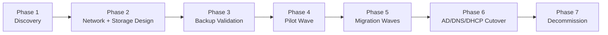

# Migration Methodology — VMware to Hyper-V / Azure Stack HCI

This is the entry point. Read this first, then follow the phase links.

This repo assumes a mid-size environment: **4-6 hypervisor hosts, 20-30
VMs**, including Active Directory domain controllers, DNS, and DHCP. The
approach scales down or up, but the wave sizing and cluster-sizing
guidance in the templates assumes roughly this order of magnitude.

## Why phases, not a big-bang cutover

Migrating 20-30 VMs in one weekend is how AD gets corrupted and nobody
can prove the new storage layer actually performs before production is
sitting on it. Every phase below produces an artifact (a report, a filled
template, a passed checklist) that the next phase depends on. Skipping a
phase doesn't save time — it moves the risk to whichever weekend you
decide to cut everything over at once.

## Phase index

| Phase | Artifact | Doc |
|---|---|---|
| 1. Discovery | VM inventory, cluster capacity CSV/JSON | [`playbooks/discover-vmware-inventory.yml`](../playbooks/discover-vmware-inventory.yml), [`scripts/Export-VMwareInventory.ps1`](../scripts/Export-VMwareInventory.ps1) |
| 2a. Network design | Filled VLAN/portgroup mapping | [`docs/network-vlan-mapping.md`](network-vlan-mapping.md) |
| 2b. Storage design | Filled FC zoning or S2D sizing worksheet | [`docs/storage-migration.md`](storage-migration.md) |
| 3. Backup validation | Passed test-restore on target platform | [`docs/backup-validation.md`](backup-validation.md) |
| 4-5. Wave planning + execution | Filled wave tracker | [`templates/migration-wave-tracker.csv`](../templates/migration-wave-tracker.csv) |
| Pre-cutover gate | Passed checklist per wave | [`docs/pre-cutover-checklist.md`](pre-cutover-checklist.md) |
| 6. AD/DNS/DHCP | *(separate repo — see note below)* | — |
| 7. Decommission | Passed checklist | [`docs/decommission-checklist.md`](decommission-checklist.md) |

**AD/DNS/DHCP cutover is intentionally not in this repo.** Domain
controllers are rebuilt fresh on the target platform and never P2V'd or
snapshot-migrated — that's a distinct runbook with its own risk profile
(FSMO transfer, SYSVOL replication convergence, USN rollback risk) and
lives in a separate project so it doesn't get bundled into routine
infra-migration tooling.

## What this repo is / isn't

**Is:** a discovery-to-cutover-readiness toolkit — pull the current
environment, design the network and storage target, prove backups work,
and track waves through a checklist gate before anything moves.

**Isn't:** an automated migration executor. Nothing here moves a VM for
you. Actual cutover still uses Azure Migrate, Veeam restore, or your
platform's native migration path — this repo gets you to the point where
that step is low-risk, and gives you the paper trail to prove it.

## Minimum viable path through this repo

If you only do three things before your first production wave:
1. Run Phase 1 discovery — you cannot size a target cluster on guesses
2. Fill the VLAN mapping — this is the #1 cause of post-migration outages
3. Pass a real test restore on the target platform (Phase 3) — a backup
   solution that's never been proven to restore on the new platform isn't
   a backup solution yet
